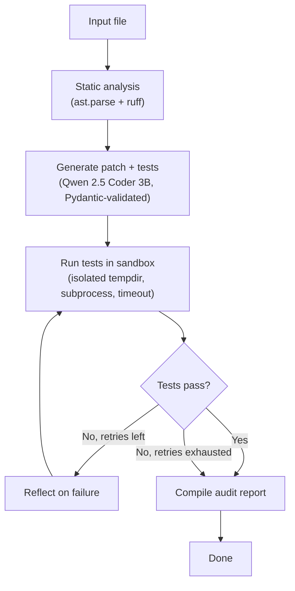

# Patchwork

A local, self-healing code-auditing agent. It reads a Python file, patches bugs, writes tests, and runs them in an isolated sandbox using a 4-bit quantized model (Qwen 2.5 Coder 3B) that fits on a 4GB laptop GPU.

Patchwork is also a 100-defect benchmark for measuring how well a 3B model can fix bugs on its own, and how much a reflection loop actually helps when it can't.

## What it does

Point it at a buggy Python file:

```bash
python -m patchwork.cli audit target.py --heal

# or specify a different model:
python -m patchwork.cli audit target.py --heal --model qwen2.5-coder:7b
```

The agent reads the file, runs `ruff` and `ast.parse` against it, sends the code to the model with instructions to find and fix the bug, and runs the model's own generated tests against its own patch in a sandboxed subprocess. If the tests fail and `--heal` is set, the agent feeds the failure output back to the model and tries again, up to 3 times. It writes the patched file, the test suite, and a Markdown audit report to disk.

Without `--heal`, it makes one attempt and reports the result. That's the difference between measuring what the model gets right immediately and what it can fix given a chance to see its own mistakes.

## Architecture



The graph is built with LangGraph. Every LLM call is schema-validated against a Pydantic model (`CodeAuditOutput`) before the graph trusts it: markdown fences get stripped, leaked test functions get removed from the patch, and anything that isn't parseable Python gets rejected outright and routed back through the reflection loop instead of silently becoming "the fix." Every subprocess call — `ruff`, `pytest` — runs with a hard timeout in a disposable temp directory. Every LLM call runs with its own timeout too, on a background thread, since a stuck generation can otherwise hang the whole process.

## Setup

```bash
python -m venv .venv
source .venv/bin/activate  # .venv\Scripts\activate on Windows
pip install -r requirements.txt
ollama pull qwen2.5-coder:3b
ollama pull qwen2.5-coder:7b  # optional: for 7B scale test
```

Requires Python 3.10+, [Ollama](https://ollama.com) running locally, and an NVIDIA GPU with 4GB+ VRAM. Developed and benchmarked on an RTX 3050 Laptop GPU.

## The benchmark

`benchmarks/dataset/` holds 100 buggy Python files across 21 categories, each paired with a hidden oracle test the agent never sees. The agent gets graded against the oracle, not its own self-written tests — a model that writes weak tests would otherwise score as "fixed" when it isn't.

```bash
python -m benchmarks.evaluate

# or evaluate a custom model and output file:
python -m benchmarks.evaluate --model qwen2.5-coder:7b --output benchmarks/results_7b.json
```

This runs all 100 defects through the full agent graph, grades each result against its oracle, and writes `benchmarks/results.json`.

### Benchmark results

Ran against `qwen2.5-coder:3b` and `qwen2.5-coder:7b` (temperature 0.0, repeat penalty 1.05) on an RTX 3050 Laptop GPU (4GB VRAM):

| Metric | Initial Run (v1.0 - 3B) | Improved Run (v1.1 - 3B) | Scale Test (7B) |
| --- | --- | --- | --- |
| Total defects | 100 | 100 | 100 |
| Categories | 21 | 21 | 21 |
| Pass@1 (fixed on first try)* | 38% | 38% | **60%** (+22) |
| Overall pass rate (within 3 retries) | 58% | 60% | **76%** (+16) |
| Confirmation bias gap (self-test vs oracle) | 17 points | 9 points | **5 points** |
| Average time per defect | 7.80s | 8.45s | 24.09s |
| Average GPU memory | 2532 MB | 2513 MB (~2.5 GB) | 2377 MB (~2.4 GB) |

*\*Pass@1 means both the fix and the generated test passed on attempt 0 without needing retries.*

The reflection loop improved the fix rate from 38% to 60% on the 3B model, and from 60% to 76% on the 7B model. Average time per defect on 3B dropped from ~29.6s in early unconstrained prototype runs (preserved in `benchmarks/first-results.json`) down to ~8s by setting generation token limits (`num_predict`), background timeouts, and cleaner test prompts. On 7B, average time per defect was ~24s because Ollama offloaded roughly 58% of the model layers to system RAM to stay cleanly within the laptop's 4GB VRAM limit.

### What improved in v1.1 and why scores changed

After analyzing the initial run, I made a few direct improvements to the agent and test harness:

- **Better retry prompt context:** When tests fail, the agent now gets the exact test code that failed and the original code as reference, instead of just the error traceback. This gives the model the full picture so it doesn't guess blindly or delete original helper functions.
- **Private helper visibility:** Fixed an import bug in the test sandbox where helper functions starting with `_` weren't visible to tests. This allowed boundary condition defects (like `incorrect_boundary_conditions_04`) to pass because tests could finally call the private validation helpers.
- **Direct connection timeouts:** Added a direct 45-second timeout on the Ollama connection so slow calls don't freeze up subsequent runs.
- **Safer unicode handling:** Fixed string unescaping so non-English characters, docstring symbols, and emojis don't get corrupted.
- **Per-attempt logs:** Saved each retry attempt in `benchmarks/results_v1_1.json` to inspect what the model tried on attempt 0 vs attempt 2.

**Why the score bumped from 58% to 60%:**
Four defects that previously failed now passed (`zip_truncation_03`, `unhashable_collections_05`, `incorrect_boundary_conditions_01`, and `incorrect_boundary_conditions_04`), largely thanks to the improved reflection context and private function visibility in the sandbox. Two defects shifted to failing due to slight local GPU generation variation, leading to a net gain of +2 defects fixed (60% overall).

**Why wasn't the score jump bigger? (The limits of a 3B model):**
You might wonder why fixing all these scaffolding bugs only moved the overall score from 58% to 60%.

The answer comes down to what agent architecture can and cannot do:
- **What scaffolding can fix:** Better reflection prompts and sandbox fixes give the model the right context to fix syntax-level mistakes, remember its original code, and retry without getting stuck. That is why boundary condition and zip truncation defects improved.
- **What scaffolding cannot fix:** Qwen 2.5 Coder 3B is a 3-billion parameter, 4-bit quantized model running locally on a laptop GPU. For categories like float precision (IEEE 754 rounding), regex character escapes, and generator state exhaustion, the model simply does not understand the underlying runtime mechanics. When an SLM fundamentally does not know how floating-point math works, feeding it the traceback just makes it generate different broken math.

In short: cleaner agent scaffolding makes the repair loop reliable and prevents crashes, but it cannot magically give a 3B model reasoning capabilities that are not in its weights.

### What happens when scaling to a 7B model?

To test whether the remaining 40% of failures in v1.1 were agent harness flaws or 3B model limits, I ran the exact same benchmark through `qwen2.5-coder:7b` (`benchmarks/results_7b.json`):

- **60% fixed on the first try (Pass@1):** 7B got 60 out of 100 defects right without needing a single retry — matching 3B's final score after 3 retries.
- **76% overall pass rate:** Fixed 76 out of 100 defects within 3 retries.
- **Cracked previous 0% categories:** 
  - `regex_special_chars` jumped from 0% (0/5) to 60% (3/5).
  - `string_strip_misuse` jumped from 0% (0/5) to 60% (3/5), correctly replacing `.strip()` with `.removesuffix()` and `.removeprefix()`.
  - `shallow_deep_copy` jumped from 25% (1/4) to 100% (4/4) using `copy.deepcopy()`.
  - `off_by_one_slicing` reached 100% (5/5).
  - `incorrect_boundary_conditions` jumped from 40% (2/5) to 80% (4/5).
- **Hard limits that still failed:** `generator_exhaustion` remained at 0% (0/5) on both 3B and 7B. Neither model understands that iterating through a generator in Python exhausts it, showing that generator lifecycle tracking is a blind spot for sub-10B models that needs deterministic static analysis rather than prompt reflection.
- **Less confirmation bias:** The gap between self-tests and hidden oracle tests shrank from 17 points down to just 5 points (81% vs 76%) because 7B writes much stricter tests that fail when its own code is broken.


### What the model is good at (and what it struggles with)

Results split cleanly by bug type:
- **100% fix rate (8 categories):** Mutable defaults, resource leaks, division rounding, iteration mutation, identity vs equality, sort-in-place returns, bitwise vs logical operators, and NoneType checks. These have obvious, local fixes — swapping an operator, adding `is None`, or using a context manager.
- **0% fix rate (6 categories):** Float precision, generator exhaustion, string `.strip()` misuse, unhashable items in sets, regex special characters, and off-by-one bounds. These bugs aren't obvious from syntax alone; they only show up at runtime (e.g. `rstrip('.com')` strips characters, not the literal suffix). A 3B model is good at syntax patterns, but struggles to simulate runtime state.

### The self-test trap (confirmation bias)

42 defects failed:
- **28 defects (67% of failures):** The model wrote self-tests that passed, but the real ground-truth tests failed.
- **14 defects (33% of failures):** The model's own self-tests failed across all 3 retries.

When the model doesn't understand a bug, it usually writes a weak test that only checks what it already got right. It watches its own test pass and assumes the bug is fixed, so the retry loop never triggers. 

If we only graded the model using its own self-tests, it would look like it had a **75% pass rate** instead of **58%**. That is why grading against hidden tests matters — it catches the 28 bugs the model thought it fixed but didn't.

### Things to keep in mind

- **Hidden tests are essential:** The 17-point difference between self-test pass rate (75%) and real pass rate (58%) shows why models shouldn't grade their own code.
- **Small hardware variations:** Even with temperature 0.0, running locally on Ollama can show minor 1–2% variations between sweeps.
- **Single-file scope:** All 100 defects are self-contained single-file functions or classes to test logic repair in isolation, without the complexity of multi-file imports.

### Edge cases handled

- **Markdown code fences:** Automatically stripped if the model wraps output in ` ```python `.
- **Leaked test functions:** If a retry puts `test_*` functions inside the solution code, they are stripped automatically.
- **Plain text responses:** Any non-code output is caught by `ast.parse` and sent back to the model to fix.
- **Stuck generation loops:** LLM calls are capped with `num_predict` and enforced with timeouts so the process never hangs.

## Project layout

``` text
patchwork/
├── cli.py                  # audit a single file from the command line
├── graph.py                 # the LangGraph state machine
├── state.py                  # AgentState, CodeAuditOutput schema + validators
├── report.py                  # Markdown audit report builder
├── tools/
│   ├── ast_inspector.py         # syntax validation, structural summary
│   ├── linter.py                  # ruff wrapper
│   └── sandbox.py                  # isolated pytest execution
└── telemetry/
    ├── profiler.py                  # VRAM/duration tracking
    └── logger.py                     # structured JSON logging

benchmarks/
├── dataset/                # 100 buggy files + 100 hidden oracle tests
├── manifest.py               # dataset schema and loaders
├── evaluate.py                 # runs the full benchmark, grades against oracles
├── results.json                  # baseline benchmark run (100 defects, 58% pass rate)
├── results_v1_1.json             # improved run with attempt history (100 defects, 60% pass rate)
├── results_7b.json               # 7B scale test run (100 defects, 76% pass rate)
└── first-results.json            # early prototype run (25 defects, ~29.6s/defect)

tests/                      # 197 tests, 93% core coverage
```

## Running the tests

```bash
ruff check patchwork/ tests/ benchmarks/
ruff format --check patchwork/ tests/ benchmarks/
mypy --strict patchwork/ benchmarks/ tests/
pytest tests/ -v --cov=patchwork --cov=benchmarks --cov-report=term-missing
```

## What's not here yet

- The CLI only fixes one file at a time; there's no batch mode outside the benchmark harness.
- No support for multi-file repositories or cross-file imports.
- The dataset could grow. 100 defects across 21 categories is enough for stable per-category rates, not enough to claim full coverage of Python's bug surface.
